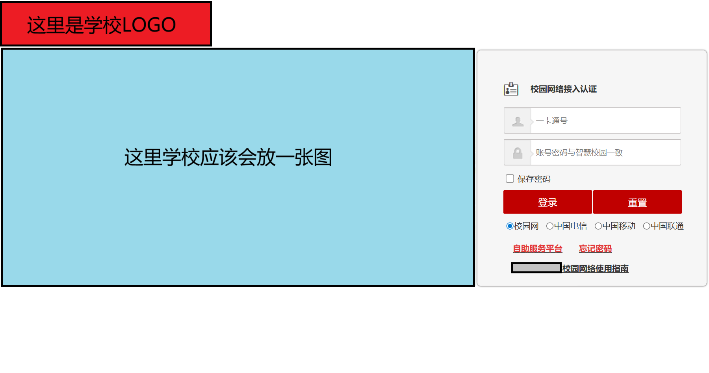

<h1 align=center><code>epauto</code></h1>

epauto是一个非常简单，针对下面界面网页登录的校园网的全自动登录工具



只需要在`config.toml`中输入校园网登陆网址和用户名，通过环境变量提供密码，然后运行epauto即可无需担心校园网的登录问题

虽然不敢保证所有类似的校园网能使用epauto，但在进行身边统计学后，至少存在其他高校使用该校园网系统，故暂时推断类似界面的校园网使用同一个系统

## 功能

- 基于配置的测试网址检测网络连通性；检测失败时自动执行校园网登录。
- 登录成功后通过WebSocket保持连接；连接超时、断开或发生异常时自动回到检测与登录流程。
- 登录失败时按可配置的递增间隔持续重试，避免频繁请求校园网服务。
- 支持自定义登录地址、账号密码、连通性检测地址、WebSocket 保活参数和配置文件路径，适合在路由器或常驻设备上长期运行。

## 如何使用

```
$ epauto --help

Usage: epauto [OPTIONS]

Options:
  -c, --config PATH  Path to configuration file.
  -v, --version      Show the version and exit.
  --help             Show this message and exit.
```

要使用epauto，需要提供校园网的登录网址、用户名和密码来让epauto通过模拟浏览器网页登陆的方式来登录校园网

epauto使用[TOML](https://toml.io/cn/v1.0.0)作为配置文件，默认读取当前目录下的`config.toml`，你可以使用`--config PATH`参数来自定义配置文件的地址

### 密码

密码通过环境变量`EPAUTO_PASSWORD`提供:

```
$ EPAUTO_PASSWORD="PASSWORD" epauto
```

也可以写在配置文件的`login.password`中；两者同时存在时以环境变量为准

> 校园网登录接口本身会以明文传输密码，这一点epauto无法改变

### 配置

[`config.toml`](config.toml)各字段含义如下:

**`[login]`**

| 字段 | 必填 | 默认值 | 说明 |
|---|---|---|---|
| `url` | 是 | | 校园网登录页面的网址 |
| `username` | 是 | | 用户名 |
| `password` | 否 | | 密码；未设置时需通过环境变量`EPAUTO_PASSWORD`提供 |
| `type` | 否 | `0` | 运营商类型: `0`校园网、`1`中国电信、`2`中国联通、`3`中国移动 |

**`[connect]`**

| 字段 | 必填 | 默认值 | 说明 |
|---|---|---|---|
| `test_url` | 是 | | 用于检测网络连通性的网址，必须是https，且应直接返回200而不是跳转 |
| `test_timeout` | 否 | `5` | 连通性检测的超时时间(秒) |
| `connect_url` | 是 | | 用于保持连接的WebSocket网址 |
| `connect_ping_interval` | 否 | `10` | WebSocket心跳间隔(秒) |
| `connect_ping_timeout` | 否 | `5` | 建立WebSocket连接的超时时间(秒) |

**`[connect.auto-close]`**

| 字段 | 必填 | 默认值 | 说明 |
|---|---|---|---|
| `enable` | 否 | `false` | 是否定时主动断开WebSocket并立即重连 |
| `duration` | 否 | `570` | 每个连接保持的时长(秒)，必须大于0 |

对于`echo.websocket.org`这类会定时断开长连接的服务端，可以启用该功能，并将`duration`设置得略短于服务端的时限，让epauto抢先重连

**`[base]`**

| 字段 | 必填 | 默认值 | 说明 |
|---|---|---|---|
| `user_agent` | 否 | `epauto/<版本号>` | 请求使用的User-Agent |
| `retry_period` | 否 | `5` | 首次重试前的等待时间(秒) |
| `retry_period_diff` | 否 | `5` | 每次重试后等待时间的增量(秒) |
| `retry_period_max` | 否 | `300` | 等待时间的上限(秒) |

## 安装

epauto仅支持Linux

### 准备工作

根据运行方式，分为两种：

**运行在宿主机:**

- [Python](https://www.python.org/downloads/) 3.11或更新
- [uv](https://docs.astral.sh/uv/) 0.13或更新

**运行在容器:**

- [Podman](https://podman.io/) 5.0或更新
- 或者 [Docker](https://docs.docker.com/engine/install/)，仅可用于运行镜像(方法1)，无法构建镜像(方法2)


### 方法1: 使用容器镜像

准备好`config.toml`后执行:

```
$ podman/docker run -d --name epauto \
    -e EPAUTO_PASSWORD="PASSWORD" \
    -v ./config.toml:/app/config.toml:ro,Z \
    ghcr.io/rintim/epauto:latest
```

在podman中，如果不希望密码出现在命令行历史中，可以使用secret:

```
$ read -rs password && printf '%s' "$password" | podman secret create epauto_password -
$ podman run -d --name epauto \
    --secret epauto_password,type=env,target=EPAUTO_PASSWORD \
    -v ./config.toml:/app/config.toml:ro,Z \
    ghcr.io/rintim/epauto:latest
```

> 如需运行主分支中的epauto，可使用`main`标签，该标签为主分支的最新构建

### 方法2: 自行构建容器镜像

> 仓库中的Dockerfile包含podman独有的内容，docker会因为无法识别而报错
>
> 考虑到针对服务器的Linux系统均自带或推荐podman，暂时不打算更改；若需要使用docker请自行调整

```
$ git clone https://github.com/rintim/epauto.git
$ cd epauto
$ podman build . -t epauto
```

构建完成后的运行方式与方法1相同，将镜像名换成`epauto`即可

### 方法3: 使用`git clone`

```
$ git clone https://github.com/rintim/epauto.git
$ cd epauto
```

修改`config.toml`的配置，然后执行:

```
$ uv sync
$ EPAUTO_PASSWORD="PASSWORD" ./.venv/bin/epauto
```

## 版权

本项目基于 [MIT license](LICENSE) 许可发布。
